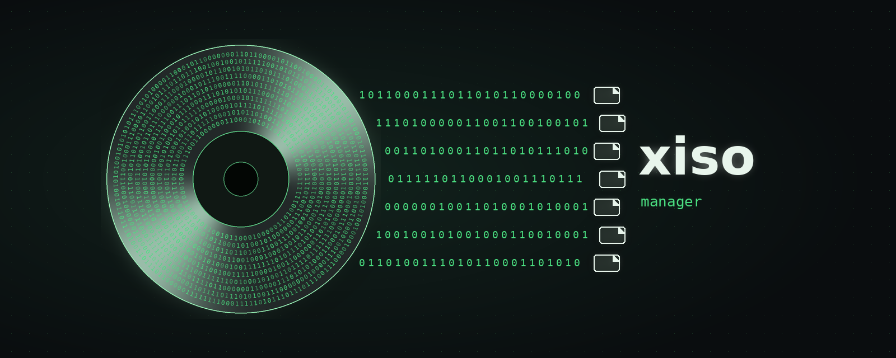
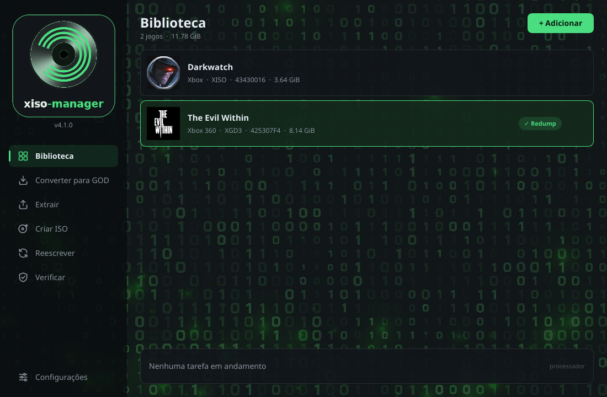
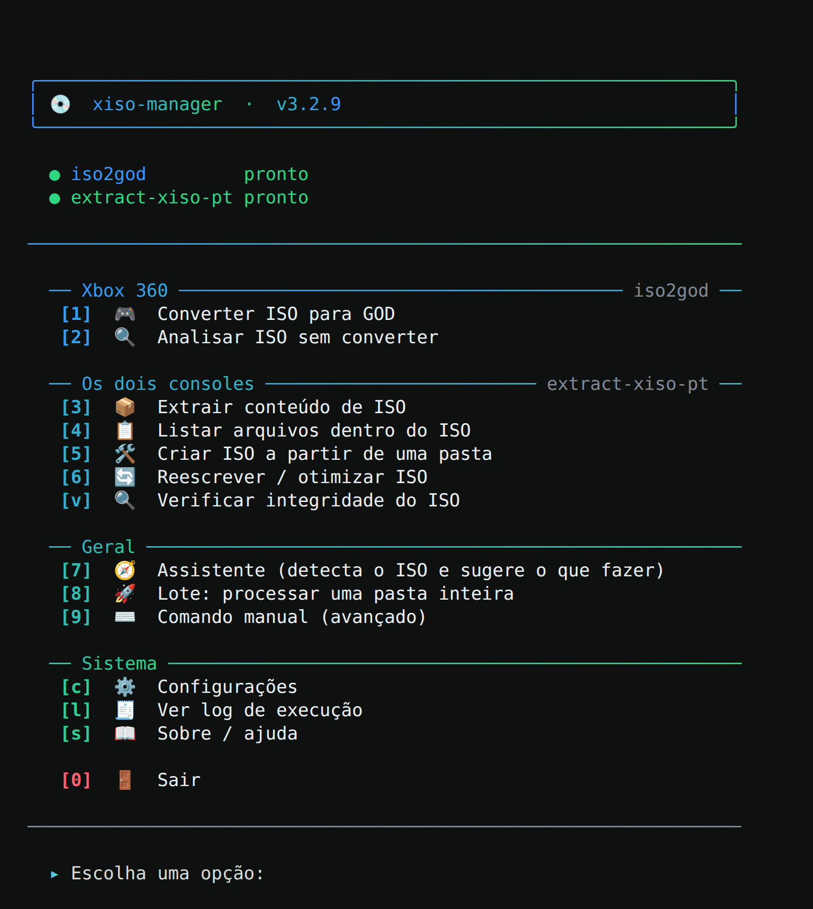

# xiso-manager



[](https://github.com/lux-insider/xiso-manager/releases/latest)
[](https://github.com/lux-insider/xiso-manager/actions/workflows/testes.yml)
[](LICENSE)


Gerenciador, em português, para imagens ISO de **Xbox** e **Xbox 360**, com
**janela** e **menu no terminal**. Reúne num lugar só o
[extract-xiso-pt](https://github.com/lux-insider/extract-xiso-pt) (extrair,
listar, criar, reescrever e verificar) e o
[iso2god-pt](https://github.com/lux-insider/iso2god-pt) (conversão para GOD).
Detecta o console de cada ISO e só oferece as ações que fazem sentido. Feito
em Rust: não precisa instalar nada.



---

## Sumário

- [Instalação](#instalação)
- [Janela](#janela)
- [Menu e opções](#o-que-cada-opção-faz)
- [Onde os arquivos são salvos](#onde-os-arquivos-são-salvos)
- [Detecção do tipo de ISO](#detecção-do-tipo-de-iso)
- [Barra de progresso](#barra-de-progresso)
- [Segurança](#segurança)
- [Configuração e arquivos](#estrutura-da-pasta)
- [Códigos de retorno](#códigos-de-retorno)
- [Problemas comuns](#problemas-comuns)
- [Testes](#testes)
- [Documentação](#documentação)
- [Licença](#licença)

---

## Instalação

A ferramenta é autocontida: tudo mora numa pasta só. Baixe da página de
[Releases](https://github.com/lux-insider/xiso-manager/releases), para Linux
x86_64, o `xiso-manager` (menu no terminal) e o `xiso-manager-gui` (a janela),
e deixe numa pasta só deles:

```bash
mkdir -p ~/Ferramentas/xiso-manager
mv ~/Downloads/xiso-manager ~/Downloads/xiso-manager-gui ~/Ferramentas/xiso-manager/
chmod +x ~/Ferramentas/xiso-manager/xiso-manager*
```

Ou compile a partir do código (Rust 1.88 ou mais novo):

```bash
git clone https://github.com/lux-insider/xiso-manager.git
cd xiso-manager && cargo build --release
cp target/release/xiso-manager ~/Ferramentas/xiso-manager/
# a janela (no Linux, precisa de: sudo apt install libfontconfig1-dev libxkbcommon-dev)
cargo build --release --features gui
cp target/release/xiso-manager-gui ~/Ferramentas/xiso-manager/
```

Ele usa duas ferramentas externas. As duas, para Linux x86_64 (glibc 2.34+),
também estão na página de
[Releases](https://github.com/lux-insider/xiso-manager/releases):

- **extract-xiso-pt** — [lux-insider/extract-xiso-pt](https://github.com/lux-insider/extract-xiso-pt):
  lista, extrai, cria, reescreve e verifica ISOs de Xbox e Xbox 360.
- **iso2god** (Xbox 360) — veja [Qual iso2god](#qual-iso2god)

Baixe, dê `chmod +x extract-xiso-pt iso2god` e deixe na pasta da ferramenta (ou em
qualquer lugar do `PATH`).

O [extract-xiso](https://github.com/XboxDev/extract-xiso) oficial do XboxDev
continua funcionando: aponte o caminho dele em **Configurações** e o menu volta
às opções dele (sem o Verificar).

Para chamar de qualquer lugar, adicione ao `~/.bashrc`:

```bash
alias xiso='~/Ferramentas/xiso-manager/xiso-manager'
```

Depois `source ~/.bashrc` uma vez. Daí em diante é só `xiso`.

### Windows

Baixe o `xiso-manager-<versão>-windows-x64.zip` da página de
[Releases](https://github.com/lux-insider/xiso-manager/releases), descompacte a
pasta inteira e dê dois cliques em **`xiso-manager-gui.exe`** (a janela) ou
em **`xiso-manager.exe`** (o menu no terminal). Roda no Windows 10/11 (64 bits)
sem instalar nada: a pasta já traz tudo.

```
xiso-manager-gui.exe      a janela
xiso-manager.exe          o menu no terminal
extract-xiso-pt.exe       extract-xiso-pt, em português
iso2god.exe               iso2god em Rust, em português
```

No Windows Terminal aparece com cores e emoji. O `Ctrl+C` funciona igual ao
Linux: espera o iso2god apagar a conversão incompleta antes de sair.

> **Windows 10:** com dois cliques, o Windows 10 abre o programa no console
> antigo, que não desenha emoji: no lugar deles aparecem caixinhas com `?`. É
> só visual, o programa funciona igual. Para ver os emojis, instale o
> [Windows Terminal](https://aka.ms/terminal) (gratuito; no Windows 11 ele já
> é o padrão) e abra o programa por ele: aperte `Win+R` e rode
> `wt "<pasta do xiso-manager>\xiso-manager.exe"`, ou clique com o botão
> direito num espaço vazio da pasta, escolha **Abrir no Terminal** e digite
> `.\xiso-manager.exe`.

Se o programa terminar com erro, a janela aberta com dois cliques espera o
ENTER antes de fechar, para dar tempo de ler a mensagem.

Para gerar o `.exe` a partir do Linux:

```bash
sudo apt install clang lld llvm
rustup target add x86_64-pc-windows-msvc
cargo install --locked cargo-xwin
cargo xwin build --release --target x86_64-pc-windows-msvc --features gui
```

### Qual iso2god

Usa o **iso2god em Rust com interface em português** (subcomandos `converter` e
`info`). O xiso-manager chama `converter --progresso-json` (a barra lê o
progresso real, em JSON) e `info --json` na análise. O binário para Linux está
na página de [Releases](https://github.com/lux-insider/xiso-manager/releases)
(`iso2god`, x86_64, glibc 2.34+): baixe, dê `chmod +x` e deixe na pasta da
ferramenta.

Outros programas chamados iso2god têm outra linha de comando e não funcionam:
se um deles estiver configurado, o xiso-manager avisa e diz onde baixar o certo.

### Detecção automática dos binários

Na primeira execução ele procura `extract-xiso-pt` (ou, na falta dele, o `extract-xiso`) e `iso2god` nesta ordem:

1. `PATH`
2. A própria pasta da ferramenta
3. `~/Downloads`, `~/Ferramentas`, `~/bin`, `~/.local/bin`
4. `/usr/local/bin`, `/usr/bin`, `/opt`
5. Pasta atual

Achando, salva o caminho e não pergunta mais. Não achando, pede o caminho na hora.
Se o binário existir mas não for executável, ele tenta o `chmod +x` sozinho.

---

## Janela

O `xiso-manager-gui` faz o mesmo que o menu, com o mouse:

- **Biblioteca:** arraste ISOs (ou uma pasta com ISOs) para a janela, ou use
  **Adicionar**. Cada jogo aparece com o nome, o ícone, o Title ID e o tipo de
  disco, lidos da própria ISO. O que já foi lido fica guardado e aparece na
  hora da próxima vez.
- **Converter para GOD, Extrair, Criar ISO, Reescrever e Verificar:** escolha
  o jogo na Biblioteca, ajuste as opções e clique no botão. O painel de baixo
  mostra a barra, a velocidade e o tempo que falta.
- **Cancelar** para a ferramenta, que apaga o que já tinha gravado. Fechar a
  janela no meio de uma tarefa faz o mesmo.
- **Fila:** com uma tarefa rodando, o botão vira **Pôr na fila**. A caixa
  **Fazer com todos os jogos da Biblioteca** enfileira um pedido por jogo.
- **Selo do Redump:** depois de Verificar, o cartão do jogo mostra
  **✓ Redump**, **Íntegra** ou **Não confere**.
- **Configurações:** as ferramentas (com a versão encontrada), a pasta padrão,
  as threads e o desenho da janela. As três primeiras são as mesmas do menu.

A janela é leve: desenhada pelo processador, usa cerca de 30 MB de memória e
fica parada quando nada muda. O trabalho pesado roda nas ferramentas, em
processos separados, então a janela nunca trava. Em **Configurações** dá para
desenhar pela placa de vídeo (OpenGL), que gasta mais memória (o driver de
vídeo).

No Linux, roda no X11 e no Wayland (arrastar arquivos para a janela, só no
X11). Precisa da glibc 2.35 ou mais nova (Ubuntu 22.04, Debian 12, Fedora 36 em
diante).

O menu no terminal continua igual:



---

## Menu

Nada de comando para decorar: as opções são escolhidas por número. O único
texto digitado é a pasta de destino.

---

## O que cada opção faz

| Opção | Ferramenta | O que faz |
|---|---|---|
| **1 GOD** | iso2god | Converte ISO de Xbox 360 para Games on Demand. Threads e padding configuráveis. |
| **2 Analisar** | iso2god | Mostra plataforma, Title ID, Media ID e título, sem converter. |
| **3 Extrair** | extract-xiso-pt | Extrai todo o conteúdo do ISO para uma pasta. Se a pasta já tiver arquivos, pergunta antes. |
| **4 Listar** | extract-xiso-pt | Mostra os arquivos de dentro do ISO sem extrair nada. |
| **5 Criar** | extract-xiso-pt | Monta um ISO a partir da pasta de um jogo de Xbox ou de Xbox 360. Aceita várias pastas na mesma execução. Em jogo de Xbox, oferece liberar o `default.xbe` para qualquer mídia (desligado por padrão). |
| **6 Reescrever** | extract-xiso-pt | Deixa o ISO enxuto (tira a partição de vídeo e o espaço vazio). Sem apagar, o novo fica ao lado como `nome.xiso.iso`; apagando, o original só é trocado depois que o novo foi gravado e conferido. |
| **v Verificar** | extract-xiso-pt | Confere a estrutura, lê o ISO inteiro e mostra CRC32, MD5 e SHA-1. Com os `.dat` do Redump instalados, diz se é a imagem original do disco. Para instalar, informe o `.zip` baixado do [redump.org](http://redump.org/downloads/) na primeira pergunta (só uma vez). |
| **7 Assistente** | ambas | Lê a assinatura do ISO, diz de qual console é e mostra só as ações que fazem sentido. A recomendada vem marcada com ⭐ e ENTER aceita ela direto. |
| **8 Lote** | ambas | Varre uma pasta inteira, separa os ISOs por console e oferece a ação certa para cada grupo. |
| **9 Manual** | ambas | Passa argumentos direto pro binário, como no terminal. |

---

## Onde os arquivos são salvos

**Converter para GOD** — a pasta de destino é obrigatória. Vai exatamente onde você mandar.

**Extrair** — se você digitar uma pasta, o conteúdo vai para ela; com vários ISOs,
cada um ganha uma subpasta com o nome dele dentro do destino (os jogos não se
misturam). Se apertar ENTER, cada ISO é extraído numa pasta com o nome dele,
**ao lado do próprio ISO**.

**Reescrever** — se você digitar uma pasta, o ISO otimizado vai para ela. Se apertar
ENTER, ele fica **na mesma pasta do original**, com o mesmo nome; o original vira
`<nome>.iso.old` (ou é apagado, se você escolher apagar). Se a reescrita falhar, o
original volta ao nome de antes.

Nos dois casos o lugar não depende mais da pasta em que você abriu o programa.
O `~` funciona (`~/Jogos/Extraidos`), e se a pasta não existir ele cria.

---

## Detecção do tipo de ISO

Lê a assinatura `MICROSOFT*XBOX*MEDIA` nos offsets conhecidos:

| Offset | Layout | Console |
|---|---|---|
| `0x10000` | XISO | o que estiver na raiz: `default.xex` = Xbox 360, `default.xbe` = Xbox |
| `0x18310000` | XGD1 | Xbox |
| `0xFDA0000` | XGD2 | Xbox 360 |
| `0x2090000` | XGD3 | Xbox 360 |

No XISO (sem partição de vídeo) a assinatura não diz o console: quem diz é o
executável na raiz do disco. O tamanho só é usado se a raiz não puder ser lida.

O resultado aparece na coluna CONSOLE da tabela de seleção, antes de você escolher,
e é cacheado para a lista não reler os arquivos a cada redesenho.

---

## Barra de progresso

```
  📦 Extraindo [█████████████░░░░░░░░░░░]  54.1%  30.0 MiB/55.6 MiB  12.8 MiB/s  ETA 00:02
```

A parte preenchida é pintada com gradiente azul → verde, e a onda desliza a cada quadro.

O percentual vem de duas fontes, nesta ordem:

1. **Percentual impresso pela ferramenta** — se ela imprimir `NN%`, esse valor manda.
2. **Monitor de destino** — uma thread soma o tamanho do que já foi gravado na pasta
   de saída e divide pelo tamanho do ISO.

Sem TTY (saída redirecionada para arquivo), imprime só uma linha limpa no final,
sem `\r`.

---

## Segurança

- Verifica espaço em disco **antes** de gravar, com 15% de margem
- Na reescrita, exige espaço para o ISO novo (o original já está no disco)
- Confirmação dupla antes de apagar ISOs originais
- `Ctrl+C` espera o iso2god apagar a conversão incompleta antes de encerrar (um
  segundo `Ctrl+C` sai na hora)
- Cria a pasta de destino se não existir e confere permissão de escrita
- Cada arquivo é processado individualmente, então um erro não derruba o lote inteiro

---

## Idioma

Português é o padrão. Em **Configurações → [1]** alterna para inglês, e a escolha fica salva.

---

## Estrutura da pasta

Tudo fica junto, na própria pasta da ferramenta:

```
~/Ferramentas/xiso-manager/
├── xiso-manager              o menu no terminal
├── xiso-manager-gui          a janela
├── extract-xiso-pt           ISOs de Xbox e Xbox 360
├── iso2god                   conversão para GOD
├── config.json               idioma, caminhos, threads, pasta padrão
├── janela.json               biblioteca e opções da janela
├── janela-cache.json         nome, ícone e selo de cada jogo já lido
├── xiso-manager.log          log de todas as execuções
└── xiso-manager.log.old      log anterior (rotaciona a cada 1 MiB)
```

Os arquivos `.json` e o log são criados sozinhos no primeiro uso.

Como os caminhos são calculados a partir da localização do próprio programa, você pode
mover ou copiar a pasta inteira para outra máquina, outro disco ou um pendrive, e ela
continua funcionando sem reconfigurar nada.

Se a pasta não for gravável (programa instalado em `/usr/local/bin`, por exemplo), config
e log caem em `~/.config/xiso-manager/` automaticamente.

O log pode ser consultado direto no menu, opção **[l]** — erros em vermelho, avisos em âmbar.

---

## Códigos de retorno

| Código | Significado |
|---|---|
| 0 | saiu pelo menu |
| 1 | erro fatal |
| 130 | interrompido com Ctrl+C |

---

## Problemas comuns

**"Permissão negada" ao rodar**
`chmod +x ~/Ferramentas/xiso-manager/xiso-manager`

**Binário aparece como ✗ não encontrado**
Mova o executável para a pasta da ferramenta ou informe o caminho em
**Configurações → [2]/[3]**.

**Caixas ou tabelas desalinhadas**
Fonte do terminal sem suporte a emoji de largura dupla. Desligue as cores em
**Configurações → [6]** ou troque para uma fonte com emoji (Noto Color Emoji).

**Sem cores**
O programa respeita `NO_COLOR` e desliga sozinho quando a saída não é um terminal.

---

## Requisitos

Linux x86_64 ou Windows 10/11 (64 bits), `extract-xiso-pt` e `iso2god`. A
janela pede o extract-xiso-pt 0.2.4 e o iso2god-pt 0.1.6 ou mais novos.

---

## Testes

- Testes automáticos das telas do menu, de cada operação e dos achados da
  auditoria (`tests/`), com ferramentas simuladas para cobrir falhas e
  cancelamentos. Eles conduzem o programa compilado pelo teclado e comparam
  cada tela, byte a byte, com a da versão anterior.
- Testes de unidade no próprio código (`cargo test`).
- **Integração contínua** no GitHub Actions, no Linux e no Windows: o
  programa, as telas e o pacote do Windows.

```bash
cargo build --release
cargo test
python3 -m unittest discover -s tests
```

---

## Documentação

| Documento | Conteúdo |
|---|---|
| [CHANGELOG.md](CHANGELOG.md) | histórico de versões |
| [AUDITORIA.md](AUDITORIA.md) | auditoria de segurança e confiabilidade, com cada achado e sua correção |

---

## Licença

Código sob a licença [MIT](LICENSE).
